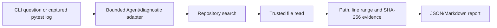

<p align="center">
  
</p>

English | [中文](README_zh.md) | [한국어](README_ko.md) | [日本語](README_ja.md)

[](https://github.com/FoundationAgents/OpenManus/stargazers)
&ensp;
[](https://opensource.org/licenses/MIT) &ensp;
[](https://discord.gg/DYn29wFk9z)
[](https://huggingface.co/spaces/lyh-917/OpenManusDemo)
[](https://doi.org/10.5281/zenodo.15186407)

# 👋 OpenManus

Manus is incredible, but OpenManus can achieve any idea without an *Invite Code* 🛫!

Our team members [@Xinbing Liang](https://github.com/mannaandpoem) and [@Jinyu Xiang](https://github.com/XiangJinyu) (core authors), along with [@Zhaoyang Yu](https://github.com/MoshiQAQ), [@Jiayi Zhang](https://github.com/didiforgithub), and [@Sirui Hong](https://github.com/stellaHSR), we are from [@MetaGPT](https://github.com/geekan/MetaGPT). The prototype is launched within 3 hours and we are keeping building!

It's a simple implementation, so we welcome any suggestions, contributions, and feedback!

Enjoy your own agent with OpenManus!

We're also excited to introduce [OpenManus-RL](https://github.com/OpenManus/OpenManus-RL), an open-source project dedicated to reinforcement learning (RL)- based (such as GRPO) tuning methods for LLM agents, developed collaboratively by researchers from UIUC and OpenManus.

## Project Demo

<video src="https://private-user-images.githubusercontent.com/61239030/420168772-6dcfd0d2-9142-45d9-b74e-d10aa75073c6.mp4?jwt=eyJhbGciOiJIUzI1NiIsInR5cCI6IkpXVCJ9.eyJpc3MiOiJnaXRodWIuY29tIiwiYXVkIjoicmF3LmdpdGh1YnVzZXJjb250ZW50LmNvbSIsImtleSI6ImtleTUiLCJleHAiOjE3NDEzMTgwNTksIm5iZiI6MTc0MTMxNzc1OSwicGF0aCI6Ii82MTIzOTAzMC80MjAxNjg3NzItNmRjZmQwZDItOTE0Mi00NWQ5LWI3NGUtZDEwYWE3NTA3M2M2Lm1wND9YLUFtei1BbGdvcml0aG09QVdTNC1ITUFDLVNIQTI1NiZYLUFtei1DcmVkZW50aWFsPUFLSUFWQ09EWUxTQTUzUFFLNFpBJTJGMjAyNTAzMDclMkZ1cy1lYXN0LTElMkZzMyUyRmF3czRfcmVxdWVzdCZYLUFtei1EYXRlPTIwMjUwMzA3VDAzMjIzOVomWC1BbXotRXhwaXJlcz0zMDAmWC1BbXotU2lnbmF0dXJlPTdiZjFkNjlmYWNjMmEzOTliM2Y3M2VlYjgyNDRlZDJmOWE3NWZhZjE1MzhiZWY4YmQ3NjdkNTYwYTU5ZDA2MzYmWC1BbXotU2lnbmVkSGVhZGVycz1ob3N0In0.UuHQCgWYkh0OQq9qsUWqGsUbhG3i9jcZDAMeHjLt5T4" data-canonical-src="https://private-user-images.githubusercontent.com/61239030/420168772-6dcfd0d2-9142-45d9-b74e-d10aa75073c6.mp4?jwt=eyJhbGciOiJIUzI1NiIsInR5cCI6IkpXVCJ9.eyJpc3MiOiJnaXRodWIuY29tIiwiYXVkIjoicmF3LmdpdGh1YnVzZXJjb250ZW50LmNvbSIsImtleSI6ImtleTUiLCJleHAiOjE3NDEzMTgwNTksIm5iZiI6MTc0MTMxNzc1OSwicGF0aCI6Ii82MTIzOTAzMC80MjAxNjg3NzItNmRjZmQwZDItOTE0Mi00NWQ5LWI3NGUtZDEwYWE3NTA3M2M2Lm1wND9YLUFtei1BbGdvcml0aG09QVdTNC1ITUFDLVNIQTI1NiZYLUFtei1DcmVkZW50aWFsPUFLSUFWQ09EWUxTQTUzUFFLNFpBJTJGMjAyNTAzMDclMkZ1cy1lYXN0LTElMkZzMyUyRmF3czRfcmVxdWVzdCZYLUFtei1EYXRlPTIwMjUwMzA3VDAzMjIzOVomWC1BbXotRXhwaXJlcz0zMDAmWC1BbXotU2lnbmF0dXJlPTdiZjFkNjlmYWNjMmEzOTliM2Y3M2VlYjgyNDRlZDJmOWE3NWZhZjE1MzhiZWY4YmQ3NjdkNTYwYTU5ZDA2MzYmWC1BbXotU2lnbmVkSGVhZGVycz1ob3N0In0.UuHQCgWYkh0OQq9qsUWqGsUbhG3i9jcZDAMeHjLt5T4" controls="controls" muted="muted" class="d-block rounded-bottom-2 border-top width-fit" style="max-height:640px; min-height: 200px"></video>

## Installation

We provide two installation methods. Method 2 (using uv) is recommended for faster installation and better dependency management.

### Method 1: Using conda

1. Create a new conda environment:

```bash
conda create -n open_manus python=3.12
conda activate open_manus
```

2. Clone the repository:

```bash
git clone https://github.com/FoundationAgents/OpenManus.git
cd OpenManus
```

3. Install dependencies:

```bash
pip install -r requirements.txt
```

### Method 2: Using uv (Recommended)

1. Install uv (A fast Python package installer and resolver):

```bash
curl -LsSf https://astral.sh/uv/install.sh | sh
```

2. Clone the repository:

```bash
git clone https://github.com/FoundationAgents/OpenManus.git
cd OpenManus
```

3. Create a new virtual environment and activate it:

```bash
uv venv --python 3.12
source .venv/bin/activate  # On Unix/macOS
# Or on Windows:
# .venv\Scripts\activate
```

4. Install dependencies:

```bash
uv pip install -r requirements.txt
```

### Browser automation

OpenManus starts Browser Use CLI 3.0 as a default MCP server:

```bash
uvx browser-use --cli-mcp
```

`uvx` keeps Browser Use and its fast-moving dependencies isolated from the
OpenManus environment. The agent receives the canonical Browser Use skill and
the native `browser_exec` and `browser_screenshot` tools.

Local mode attaches to Chrome or Chromium automatically and needs no API key.
For diagnostics or to install Chromium, run:

```bash
uvx browser-use --doctor
uvx browser-use install
```

For an isolated Browser Use Cloud browser, authenticate before starting
OpenManus. The agent can then start and select a named remote browser:

```bash
export BROWSER_USE_API_KEY="bu_..."
```

Existing browsers can be selected with `BU_CDP_URL`, `BU_CDP_WS`, or `BU_NAME`.
Set `OPENMANUS_DISABLE_BROWSER_USE=1` to disable the default Browser Use MCP
server.

BrowserGym still requires its Playwright browser:

```bash
playwright install
```

## Configuration

OpenManus requires configuration for the LLM APIs it uses. Follow these steps to set up your configuration:

1. Create a `config.toml` file in the `config` directory (you can copy from the example):

```bash
cp config/config.example.toml config/config.toml
```

2. Edit `config/config.toml` to add your API keys and customize settings:

```toml
# Global LLM configuration
[llm]
model = "gpt-4o"
base_url = "https://api.openai.com/v1"
api_key = "sk-..."  # Replace with your actual API key
max_tokens = 4096
temperature = 0.0

# Optional configuration for specific LLM models
[llm.vision]
model = "gpt-4o"
base_url = "https://api.openai.com/v1"
api_key = "sk-..."  # Replace with your actual API key
```

## Quick Start

One line for run OpenManus:

```bash
python main.py
```

Then input your idea via terminal!

For MCP tool version, you can run:
```bash
python run_mcp.py
```

For unstable multi-agent version, you also can run:

```bash
python run_flow.py
```

### Custom Adding Multiple Agents

Currently, besides the general OpenManus Agent, we have also integrated the DataAnalysis Agent, which is suitable for data analysis and data visualization tasks. You can add this agent to `run_flow` in `config.toml`.

```toml
# Optional configuration for run-flow
[runflow]
use_data_analysis_agent = true     # Disabled by default, change to true to activate
```
In addition, you need to install the relevant dependencies to ensure the agent runs properly: [Detailed Installation Guide](app/tool/chart_visualization/README.md##Installation)

## How to contribute

We welcome any friendly suggestions and helpful contributions! Just create issues or submit pull requests.

Or contact @mannaandpoem via 📧email: mannaandpoem@gmail.com

**Note**: Before submitting a pull request, please use the pre-commit tool to check your changes. Run `pre-commit run --all-files` to execute the checks.

## Community Group
Join our networking group on Feishu and share your experience with other developers!

<div align="center" style="display: flex; gap: 20px;">
    
</div>

## Star History

[](https://star-history.com/#FoundationAgents/OpenManus&Date)

## Sponsors
Thanks to [PPIO](https://ppinfra.com/user/register?invited_by=OCPKCN&utm_source=github_openmanus&utm_medium=github_readme&utm_campaign=link) for computing source support.
> PPIO: The most affordable and easily-integrated MaaS and GPU cloud solution.


## Acknowledgement

Thanks to [anthropic-computer-use](https://github.com/anthropics/anthropic-quickstarts/tree/main/computer-use-demo), [browser-use](https://github.com/browser-use/browser-use) and [crawl4ai](https://github.com/unclecode/crawl4ai) for providing basic support for this project!

Additionally, we are grateful to [AAAJ](https://github.com/metauto-ai/agent-as-a-judge), [MetaGPT](https://github.com/geekan/MetaGPT), [OpenHands](https://github.com/All-Hands-AI/OpenHands) and [SWE-agent](https://github.com/SWE-agent/SWE-agent).

We also thank stepfun(阶跃星辰) for supporting our Hugging Face demo space.

OpenManus is built by contributors from MetaGPT. Huge thanks to this agent community!

## Cite
```bibtex
@misc{openmanus2025,
  author = {Xinbing Liang and Jinyu Xiang and Zhaoyang Yu and Jiayi Zhang and Sirui Hong and Sheng Fan and Xiao Tang and Bang Liu and Yuyu Luo and Chenglin Wu},
  title = {OpenManus: An open-source framework for building general AI agents},
  year = {2025},
  publisher = {Zenodo},
  doi = {10.5281/zenodo.15186407},
  url = {https://doi.org/10.5281/zenodo.15186407},
}
```

## DevFlow-Agent research extension

This checkout also contains a bounded, read-only software-engineering prototype built on the fixed OpenManus source baseline. It is intended for local demonstrations and engineering interviews; it is not a general-purpose autonomous coding agent.

| Capability | Current status |
|---|---|
| Repository indexing, keyword/symbol search, trusted reads | **VERIFIED** in deterministic synthetic-repository tests |
| OpenManus ToolCollection with exactly two read-only tools | **VERIFIED** in offline integration tests |
| M1.5 answer-quality checks (bounded arithmetic and citations) | **VERIFIED** deterministically; preserved real run remains historical exit code 3, with a separate offline re-evaluation |
| CI failure diagnosis from captured pytest logs | **PARTIAL**: deterministic five-case slice and CLI demo pass; real Qwen obtained source evidence but its bounded final response was truncated |
| Diff-only proposal, SQLite-backed independent approval, one-time receipt, isolated synthetic apply/test | **VERIFIED** for the bounded control flow; not registered as a production write tool |
| Model-generated file edits, sandboxed tests, autonomous repair | **NOT_VERIFIED / NOT_RUN** |

The current read-only data flow is:



For the deterministic CI diagnosis demo, run from this checkout:

```powershell
.\.venv\Scripts\python.exe -m devflow_agent.cli diagnose --repo tests/fixtures/repos/m2_ci_demo --log tests/fixtures/logs/m2_assertion_total.log --exit-code 1 --format json
.\.venv\Scripts\python.exe -m unittest tests.devflow_agent.test_m2_diagnostics -v
\.venv\Scripts\python.exe -m unittest tests.devflow_agent.test_m2_output_contract tests.devflow_agent.test_m3_patch_flow -v
\.venv\Scripts\python.exe -m unittest tests.devflow_agent.test_m3_ledger -v
\.venv\Scripts\python.exe scripts/demo_m3_repair.py --approve
```

The implementation is intentionally read-only: it does not register Bash, Python execution, file editing, MCP write tools, or arbitrary commands from a log. Detailed evidence and current limitations are in [`reports/public/M2_CI_DIAGNOSTICS_2026-10-23.md`](reports/public/M2_CI_DIAGNOSTICS_2026-10-23.md), [`docs/ARCHITECTURE_DECISIONS.md`](docs/ARCHITECTURE_DECISIONS.md), and [`docs/INTERVIEW_STORY.md`](docs/INTERVIEW_STORY.md). M2 remains **PARTIAL** after the single permitted 4096-context follow-up: the real model completed search, two trusted reads, and an untruncated cited answer, but the bounded numeric gate returned **UNVERIFIABLE** for the project-specific `total([1, -1])` call and the acceptance exited `1`. The run evidence is preserved; no retry was made.

The M3 demonstration is deliberately separate from the read-only Agent tools. It creates a proposal from a trusted file digest, persists the proposal and independent reviewer decision in a temporary SQLite ledger, prints a standard diff, consumes the approval once, and applies only to a temporary copy. The fixed `pytest -q` runner records bounded output, exit codes, and timeout cleanup evidence. The source fixture remains unchanged. This is a controlled synthetic process runner, not a claim of OS-level sandboxing or model-generated patch selection. The latest real-model M2 follow-up was executed once with Qwen3.5-4B at context 4096 and max output 1536. Health, model identity, tool pairing, trusted-read citations, fixture immutability, and process cleanup passed; the numeric quality gate remained UNVERIFIABLE, so M2 is still PARTIAL.

### M4 evidence-driven repair workflow

M4 adds a small, deterministic coordinator in [`devflow_agent/repair_workflow.py`](devflow_agent/repair_workflow.py). It composes the existing pytest diagnosis, trusted source evidence, SHA-256-bound diff proposal, explicit reviewer decision, SQLite ledger, one-time isolated apply, and fixed test runner. The workflow emits a sanitized JSON run report with ordered state events; read-only replay verifies state, approvals, hashes, test receipts, evidence, and cleanup proof without executing a write.

Run the synthetic demonstration:

```powershell
.\.venv\Scripts\python.exe scripts\demo_m4_workflow.py
.\.venv\Scripts\python.exe scripts\demo_m4_workflow.py --approve --run-id m4-demo-local
```

The first command stops at `APPROVAL_PENDING`; the second uses a clearly labeled synthetic reviewer and applies only to a disposable copy. The source fixture remains unchanged. The M4 control flow is **VERIFIED** for the deterministic synthetic scope; model-generated patch selection, real user-repository writes, OS-level sandboxing, Docker isolation, and autonomous re-planning remain **NOT_VERIFIED**. See [`docs/M4_EVIDENCE_WORKFLOW.md`](docs/M4_EVIDENCE_WORKFLOW.md) and the latest independent sanitized run summary [`reports/public/M4_REPAIR_WORKFLOW_2026-10-23-AUDIT.md`](reports/public/M4_REPAIR_WORKFLOW_2026-10-23-AUDIT.md).


### Latest bounded M2 real run

- Run ID: `20261023T-m2-qwen35-4b-r6-ctx4096`
- Command: `powershell -ExecutionPolicy Bypass -File .\scripts\run_m2_real_model_case.ps1 -RepoRoot <repo-root> -ModelRoot <model-root> -RunId 20261023T-m2-qwen35-4b-r6-ctx4096`
- Model/runtime: Qwen3.5-4B Q4_K_M / llama.cpp b11424; `127.0.0.1:11434`; context `4096`; max output `1536`.
- Trace: search → trusted read (`src/totals.py`) → trusted read (`tests/test_totals.py`) → final answer; `finish_reason=stop`.
- Quality: citations **PASS**, numeric quality **UNVERIFIABLE**, overall **PARTIAL**; no writes or Task B.
- Evidence: the preserved raw run is intentionally kept out of the public baseline because it contains machine-local paths; the sanitized summary is in [`reports/public/M2_CI_DIAGNOSTICS_2026-10-23.md`](reports/public/M2_CI_DIAGNOSTICS_2026-10-23.md).


The M2 quality gate now classifies bounded project-function claims separately from arithmetic expressions. A simple trusted-read function such as `def total(values): return sum(values)` can be statically checked without executing project code; branches, dynamic calls, external state, missing evidence, and source-test expectation text remain fail-closed. The preserved real answer from `20261023T-m2-qwen35-4b-r6-ctx4096` was re-evaluated offline and remains `UNVERIFIABLE` for numeric quality, so M2 remains PARTIAL.

Offline re-evaluation command:

```powershell
.\.venv\Scripts\python.exe scripts/recheck_m2_saved_answer.py
```

### Interview demo entry

The frozen M1–M3 demo surface is exposed through one bounded PowerShell
launcher. It checks the project environment and never starts a model, sends an
API request, kills a process, or writes a real workspace:

```powershell
powershell -ExecutionPolicy Bypass -File .\scripts\run_interview_demo.ps1 -Demo check
powershell -ExecutionPolicy Bypass -File .\scripts\run_interview_demo.ps1 -Demo m2
powershell -ExecutionPolicy Bypass -File .\scripts\run_interview_demo.ps1 -Demo m3
```

`m2` creates a new summary that points to the preserved Qwen3.5-4B run and its
offline quality reassessment. It does not rerun the model; the historical M2
status remains `PARTIAL` because numeric quality is `UNVERIFIABLE`. `m3` runs
the deterministic synthetic repair demonstration with an independent synthetic
reviewer and an isolated copy. It does not claim model-generated repair or an
OS-level sandbox. See [`docs/INTERVIEW_OUTLINE.md`](docs/INTERVIEW_OUTLINE.md)
for the short interview explanation and exact evidence boundary.
