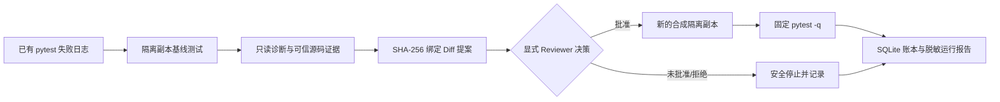

# M4 证据驱动修复工作流

M4 把 M1 的可信仓库读取、M2 的 pytest 失败诊断和 M3 的补丁审批/隔离测试连接成一个有界的控制流。当前实现是 `devflow_agent/repair_workflow.py`，不向 OpenManus ToolCollection 注册写入工具，也不修改真实用户仓库。

## 数据流



状态迁移按服务端白名单执行：`CREATED` → `BASELINE_TESTED` → `DIAGNOSED` → `PATCH_PROPOSED` → `APPROVAL_PENDING` → `APPROVED` → `APPLIED` → `VERIFYING` → `COMPLETED`。基线、诊断、审批、应用、验证或持久化错误会进入明确的失败状态，不能自动变成成功。

每个运行有独立的 `run_id`、`task_id`、`proposal_id` 和报告事件序号。补丁提案绑定工作区、规范化相对路径、原始文件 SHA-256、替换内容 SHA-256 和 unified diff SHA-256。SQLite 账本记录审批决定、一次性收据和两阶段测试结果。`RESULT_UNKNOWN`、过期文件、账本错误和路径越界都 fail-closed。

## 演示

在项目根目录运行：

```powershell
.\.venv\Scripts\python.exe scripts\demo_m4_workflow.py
.\.venv\Scripts\python.exe scripts\demo_m4_workflow.py --approve --run-id m4-demo-local
```

无 `--approve` 时只创建提案并停在 `APPROVAL_PENDING`；`--approve` 使用明确标记的合成 reviewer，将补丁应用到一次性合成副本并运行固定 `pytest -q`。每次运行都拒绝覆盖已有运行目录，并在 `reports/m4_workflow_runs/<run-id>/run-report.json` 保存可回放报告和 SQLite 账本。

只读回放不会打开工作区、应用补丁或执行测试；它会核验事件顺序以及 VERIFIED 报告中的审批、哈希、测试收据、可信证据和隔离副本清理证明：

```python
from devflow_agent.repair_workflow import RepairWorkflow
print(RepairWorkflow.replay_report("reports/m4_workflow_runs/<run-id>/run-report.json"))
```

## 验收边界

本轮确定性测试覆盖审批前零写入、拒绝、过期文件、路径穿越、账本持久化失败、验证失败、一次性消费、隔离副本清理失败和篡改报告拒绝。合成演示的源目录哈希在运行前后保持不变，隔离副本和测试进程在完成后清理；清理证据缺失时不会标记 `VERIFIED`。

这证明的是可审计的合成控制流。真实模型自主生成补丁、真实个人仓库写入、OS 级沙箱、Docker 隔离和失败后自主重规划仍为 `NOT_VERIFIED`；当前没有启动模型、调用外部 API 或执行 Task B。
