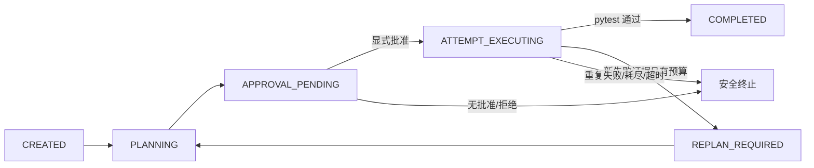

# M5 有界自主重规划

M5 在 M4 单次修复工作流之上增加有限的重规划控制面。实现位于 `devflow_agent/bounded_replanning.py`，继续复用 M4 的诊断、可信读取、哈希绑定补丁、独立审批、SQLite 账本、一次性隔离应用和固定 `pytest -q` 验证。它没有注册新的 Agent 写入工具，也不会修改源工作区。

## 设计边界

- 默认 `max_replans=1`，因此最多执行两次候选尝试；允许的配置范围为 0–3。单个候选仍只允许一个白名单文件，替换内容默认不超过 256 KiB。
- 每次候选必须声明尝试编号、原因、目标路径、源文件 SHA-256，并绑定当前失败证据指纹。
- 每次尝试使用独立的 M4 `RepairWorkflow`、SQLite 账本和报告。这样每个补丁仍只有一次审批、一次消费和一份收据，不改变 M4 的回放合同。
- 第一次验证失败后，M5 保存退出码、原始输出 SHA-256、去除易变测试时长后的失败指纹、截断状态和有界诊断摘要。下一次候选只能绑定这份最新证据。
- 相同失败指纹、重复候选、缺失证据、超范围路径、审批缺失/拒绝、文件过期、账本错误、结果未知、测试超时或预算耗尽都会进入明确终态。
- 顶层报告只读回放会验证事件顺序、尝试预算、证据链、候选范围、嵌套 M4 报告哈希、审批、收据、测试状态和源工作区不变证明。回放不会重新执行补丁或测试。

## 状态流



候选生成器和 Reviewer 是两个独立接口。合成演示使用明确标记的确定性候选生成器与合成独立 Reviewer；这验证控制流，不证明真实模型能够自主生成正确补丁。

## 演示

未传 `--approve` 时，工作流停在审批门前且没有写入收据：

```powershell
.\.venv\Scripts\python.exe scripts\demo_m5_replanning.py `
  --output-dir reports\m5_workflow_runs\m5-preview
```

显式批准的合成演示中，第一个候选故意使测试继续失败；第二个候选绑定新的失败证据后通过：

```powershell
.\.venv\Scripts\python.exe scripts\demo_m5_replanning.py `
  --output-dir reports\m5_workflow_runs\m5-approved `
  --run-id m5-approved --approve
```

输出目录必须不存在，避免覆盖历史证据。原始账本与运行报告位于本地忽略目录 `reports/*_workflow_runs/`；公开版本只保留脱敏验收摘要。

## 已验证范围

- 首次修复失败后，第二次候选使用最新失败证据并通过。
- 不同失败达到预算后停止；相同失败不会无限循环。
- 缺少失败证据或候选不在允许路径范围内时 fail-closed。
- 每次候选都重新经过 M4 的显式审批、一次性消费、隔离应用和测试。
- 账本持久化失败、未审批、拒绝审批和篡改回放不会产生成功状态。
- 合成演示的源仓库运行前后 SHA-256 相同；只读回放不执行写入或测试。

## 未验证范围

- 真实模型自主生成第一或第二个补丁。
- 真实用户仓库写入。
- OS 级沙箱、容器隔离或对不可信测试的完整主机防护。
- 崩溃后的可写恢复、并发运行或跨进程审批暂停。
- 测试失败之外的通用规划和自然语言任务分解。
